

  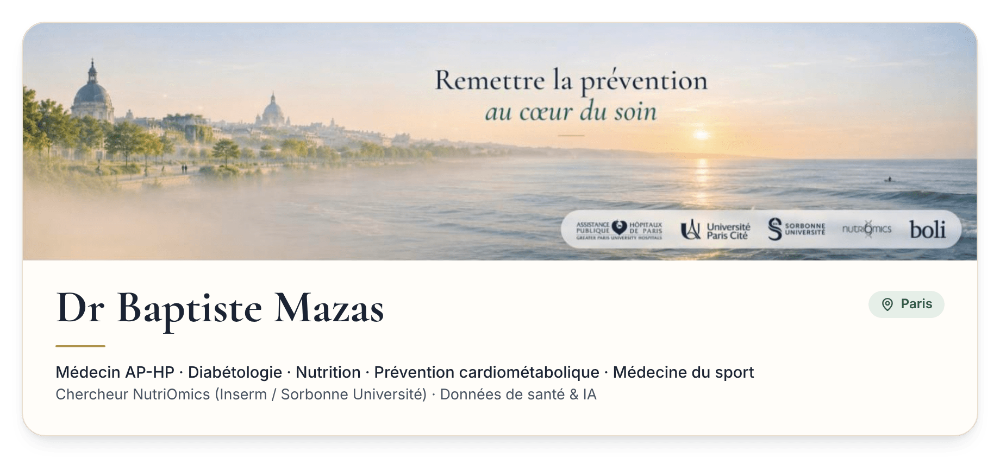

  
  
  
  
  

  Je partage ici ce que je construis et ce que j'apprends : veille scientifique, outils en accès libre, 
  projets en santé numérique, recherche et enseignement.

<picture>
  <source media="(prefers-color-scheme: dark)" srcset="assets/titre-veille-sombre.png">
  
</picture>

<picture>
  <source media="(prefers-color-scheme: dark)" srcset="assets/titre-outils-sombre.png">
  
</picture>

<a href="https://baptistemazas-nutrition.github.io/cotation/">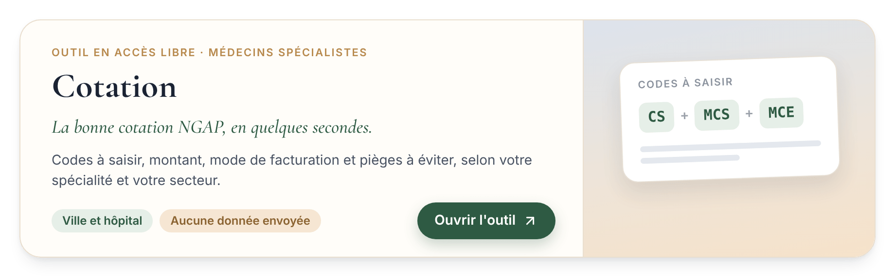</a>

<a href="https://baptistemazas-nutrition.github.io/sosie/">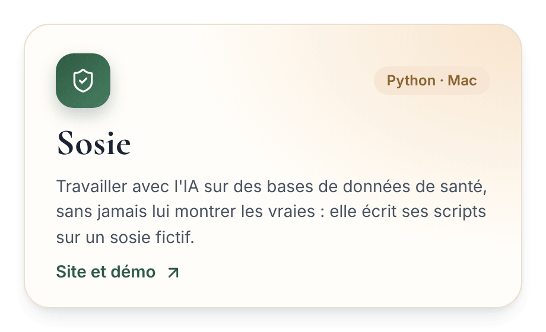</a><a href="https://github.com/baptistemazas-nutrition/manuscript-agents-marketplace">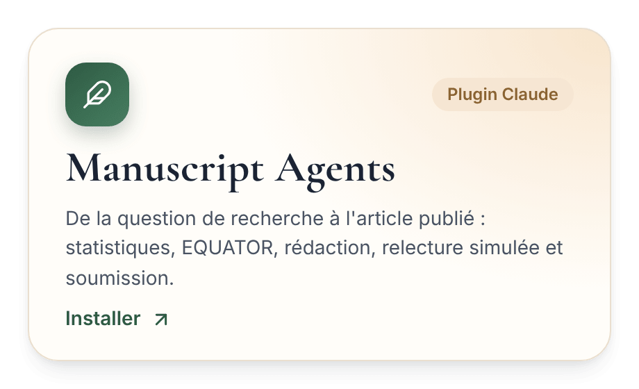</a> 
<a href="https://baptistemazas-nutrition.github.io/sous-titres/">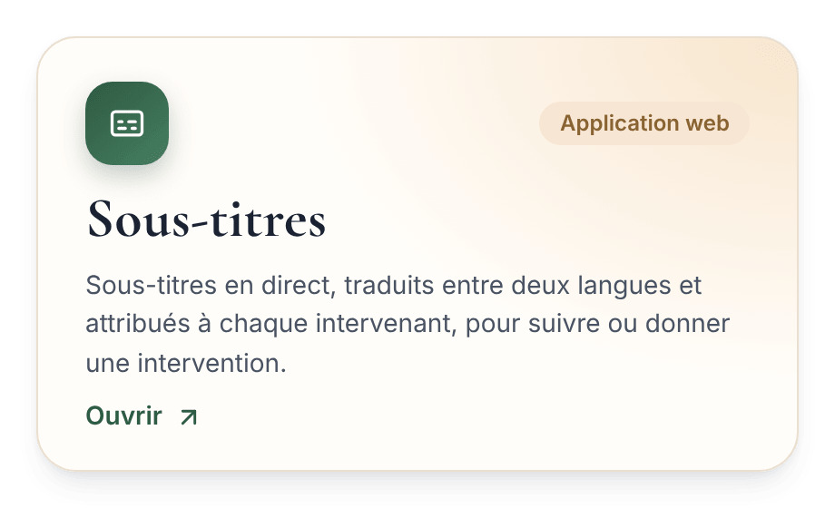</a><a href="https://remboursementglp1.netlify.app/">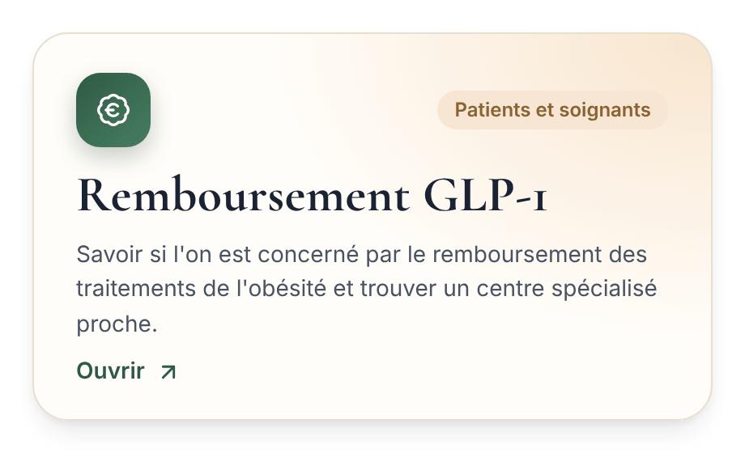</a>

Code source : <a href="https://github.com/baptistemazas-nutrition/cotation">Cotation</a> · <a href="https://github.com/baptistemazas-nutrition/sosie">Sosie</a> · <a href="https://github.com/baptistemazas-nutrition/sous-titres">Sous-titres</a> · Manuscript Agents est dérivé d'Academic Research Skills (licence CC BY-NC 4.0).

<picture>
  <source media="(prefers-color-scheme: dark)" srcset="assets/titre-projets-sombre.png">
  
</picture>

<a href="https://baptistemazas-nutrition.github.io/le-radar-paris/">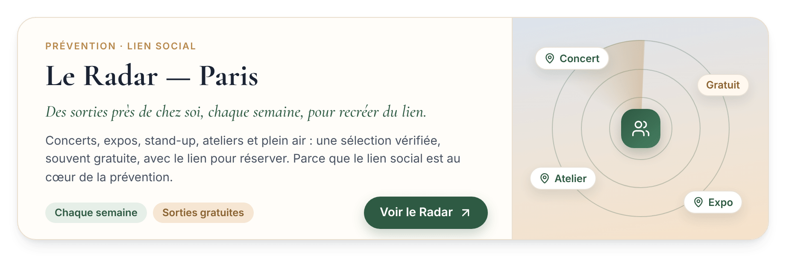</a>

<a href="https://activ-ordo.netlify.app/">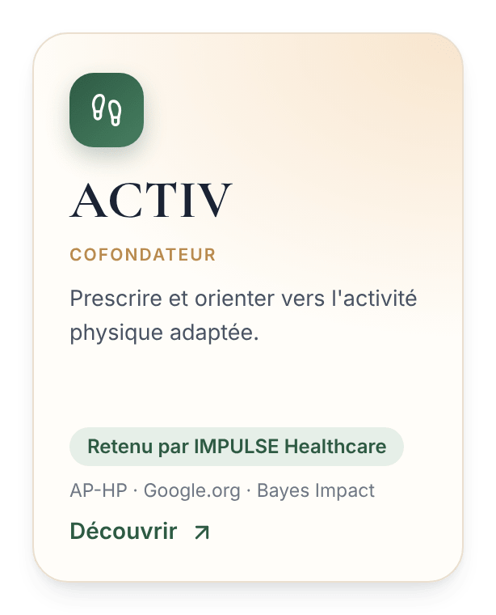</a><a href="https://baptistemazas-nutrition.github.io/sano/">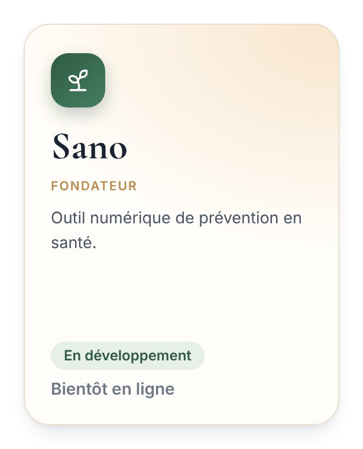</a><a href="https://boli.care/">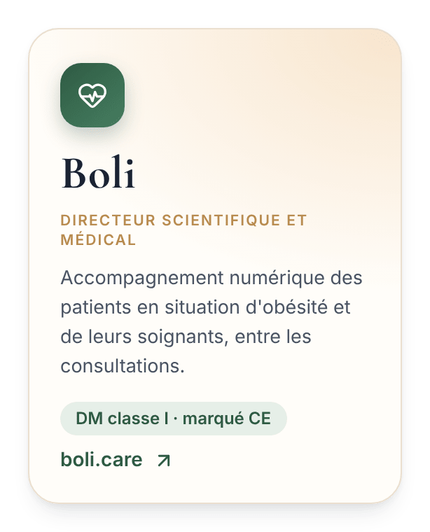</a>

Code source : <a href="https://github.com/baptistemazas-nutrition/le-radar-paris">Le Radar</a> · <a href="https://github.com/baptistemazas-nutrition/sano">Sano</a>

<picture>
  <source media="(prefers-color-scheme: dark)" srcset="assets/titre-recherche-sombre.png">
  
</picture>

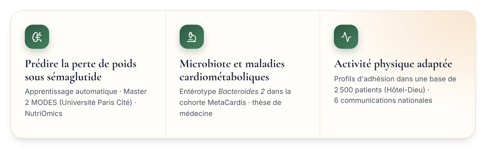

<picture>
  <source media="(prefers-color-scheme: dark)" srcset="assets/titre-enseignement-sombre.png">
  
</picture>

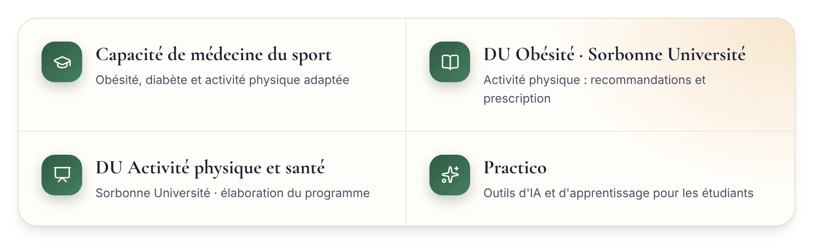

**Publications didactiques**

- Mazas B., Bel Lassen P., Merat B., Perrard L., Desroche L.-M. *Prise en charge de l'obésité par le cardiologue.* Protocole École Numérique de Cardiologie, 2026.
- Mazas B., Andreelli F., Bourron O. *Physiopathologie de la neuropathie diabétique périphérique.* Médecine des Maladies Métaboliques, 2026.
- *Cœur et obésité.* EMC, Elsevier Masson — co-rédaction avec le Pr J.-M. Oppert, 2026.

Membre de la SFNCM (groupes Jeunes et Communication), de la SFE et de l'ESE. Pour me contacter : un message sur LinkedIn.

<picture>
  <source media="(prefers-color-scheme: dark)" srcset="assets/signature-sombre.png">
  
</picture>

**Transparence.** Liens d'intérêts : directeur scientifique et médical de Boli (Boli Care SAS).

Les contenus partagés ici ont une visée d'information et de formation ; ils ne remplacent pas une consultation médicale. Dernière mise à jour : novembre 2026.
